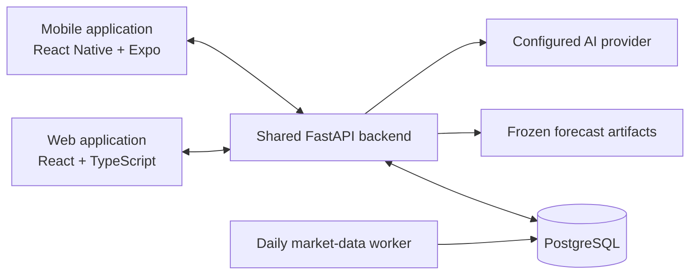

# Aura

**Portfolio Risk Education Platform**

[](web-prototype-react/package.json)
[](mobile/package.json)
[](backend/requirements.txt)
[](backend/app/database/connection.py)
[](aura-test-database.yml)

Aura helps beginner and retail investors understand the risks inside their
portfolios, explore alternative allocations, and learn how market conditions
affect their holdings. It combines portfolio analytics, historical what-if
simulations, model-based outlooks, and grounded AI explanations in a shared web
and mobile experience.

The goal is to make portfolio risk understandable: which assets drive it, how
concentrated an allocation is, how holdings behave together, and what past
market events can teach us about a proposed investment plan.

## Product capabilities

| Capability | What users can do |
| --- | --- |
| Current portfolios | Record asset quantities and review allocations derived from persisted market prices. |
| Planned portfolios | Enter proposed investment amounts in USD or THB and explore a hypothetical allocation before recording actual holdings. |
| Historical analysis | Review returns, volatility, maximum drawdown, Sharpe ratio, correlation, concentration, diversification, and ranked risk drivers. |
| What-if simulations | Explore historical market scenarios, compare allocations, or combine a scenario with an allocation change. |
| Reports and history | Reopen saved analysis and simulation snapshots with the values and context captured at creation. |
| Forecast Outlook | Explore asset and portfolio return and volatility estimates across 7, 14, 21, and 30 calendar days, with model context and limitations. |
| AI assistant | Ask for explanations grounded in backend analytics and saved report or simulation results. |
| Watchlist | Follow supported assets and open their individual outlooks without creating a portfolio. |
| Learning and preferences | Use educational content, locally saved learning progress, portfolio-value privacy controls, and account settings. |
| In-app notifications | Receive account-scoped analysis and simulation notifications and manage notification preferences. |

Supported portfolio amounts can be displayed in **USD or THB** when the backend
has suitable exchange-rate data. Currency display does not change allocations,
returns, or risk calculations.

### Supported assets

The current asset catalog contains 17 instruments:

| Category | Symbols |
| --- | --- |
| Equities | AAPL, MSFT, TSLA, NVDA, AMZN, GOOGL, META |
| ETFs | SPY, QQQ, DIA, VTI, GLD, SLV, BND, TLT |
| Cryptocurrencies | BTC-USD, ETH-USD |

Market observations are daily historical data rather than streaming quotes.
USD/THB exchange-rate observations support the platform's currency views.

## A typical workflow

1. **Create a portfolio.** Record quantities for current holdings or proposed
   amounts for a planned allocation.
2. **Understand the baseline.** Review historical performance, diversification,
   correlations, and the assets contributing most to portfolio risk.
3. **Explore alternatives.** Compare allocations and historical scenarios, then
   save the results for later review.
4. **Review an outlook.** Inspect return and volatility estimates alongside their
   data dates, model information, uncertainty, and warnings.
5. **Learn from the results.** Use the assistant and educational content to
   understand the calculations and their limitations.

## How Aura handles results

- **The backend owns financial calculations.** Web and mobile clients present
  shared API results rather than implementing separate analytics formulas.
- **Historical analysis and simulations use observed data.** Saved results
  preserve their original context; reopening history does not recalculate it
  against today's holdings or prices.
- **Forecasting is a separate model-based capability.** Production inference
  consumes frozen, versioned artifacts. Model training and evaluation happen
  offline rather than during a user's request.
- **The assistant explains existing evidence.** It uses backend-owned analytics
  and saved snapshots instead of inventing portfolio metrics. Forecast Outlook
  is presented separately from the assistant's current grounding scope.
- **Data availability is visible.** Stale observations, missing artifacts, and
  insufficient history can make an analysis or outlook unavailable.

The 30-day outlook is the default. The 7-, 14-, and 21-day outlooks are
**experimental educational features** with mixed model quality; they are not
approved as reliable predictions. Asset outlooks include available prediction
ranges, while portfolio outlooks do not invent portfolio prediction intervals.

Aura is intended for education. It does not execute trades or provide
personalized buy/sell recommendations. Historical results and model estimates
do not guarantee future performance.

## Technology

| Layer | Technologies |
| --- | --- |
| Customer web | React, TypeScript, Vite |
| Mobile | React Native, TypeScript, Expo |
| Shared API | Python 3.13, FastAPI, Pydantic |
| Persistence | PostgreSQL, SQLAlchemy, Alembic |
| Analytics | pandas, NumPy, deterministic analytics modules |
| Forecasting | scikit-learn, statsmodels, offline evaluation and versioned artifacts |
| Market-data processing | Backend fetching, cleaning, validation, and an APScheduler worker |
| AI explanations | Configurable OpenAI or Groq provider |

Authenticated resources are scoped to their owning account. Web access tokens
last 30 minutes, with rotating HttpOnly refresh cookies supporting sessions that
expire after seven days of inactivity or 30 days from the original sign-in.
Logout and password changes revoke web sessions.

## System architecture

The web and mobile applications use one FastAPI backend. It owns authentication,
portfolio calculations, persistence, and the coordination of model inference and
AI explanations. A separate worker keeps persisted market observations updated.



See the [system architecture document](docs/architecture/System_Architecture.md)
for component responsibilities, folder definitions, and architectural decisions.
The [public API contract](docs/api_contracts/public_api.md) describes the current
HTTP behavior and authentication rules.

## Repository layout

```text
AURA/
  backend/                Shared API, analytics, simulations, forecasting, and persistence
  web-prototype-react/    Customer web application
  mobile/                 Customer mobile application
  data/                   Generated local market-data pipeline outputs
  docs/                   Architecture, API contracts, and development guides
  PROJECT_CONTEXT.md      Product scope and project context
  CURRENT_STATUS.md       Implementation checkpoints and verification history
  AGENTS.md               Repository working instructions
```

## Local development

### Prerequisites

- Python 3.13.
- Node.js and npm.
- Docker with Docker Compose for the local PostgreSQL database.
- Backend and client environment configuration.
- Persisted market observations for data-dependent features, and the reviewed
  artifact packages for Forecast Outlook.

### 1. Prepare dependencies

Run from the repository root. These commands use Windows PowerShell:

```powershell
python -m venv .venv
.\.venv\Scripts\python.exe -m pip install -r backend/requirements.txt
npm ci --prefix web-prototype-react
```

On macOS or Linux, use `.venv/bin/python` for virtual-environment commands.

### 2. Configure a fresh local environment

For a fresh setup with no existing environment or local secret files:

```powershell
docker compose -f aura-local-env-setup.yml run --rm env-setup
```

The setup creates ignored backend, web, and test-database configuration plus a
local database password file. It generates credentials without printing them
and stops if its target files already exist. For existing environments or
macOS/Linux setup, follow the
[environment setup guide](docs/development/local-environment-setup.md).

Use [backend/.env.example](backend/.env.example) and the client environment
examples as configuration references. Keep real credentials in local environment
files or the deployment host's secret configuration.

### 3. Start PostgreSQL and apply migrations

```powershell
docker compose --env-file .env.test-database -f aura-test-database.yml up -d
.\.venv\Scripts\python.exe -m alembic -c backend/alembic.ini upgrade head
```

Wait for the database to become healthy before applying migrations. Alembic uses
the database selected by `DATABASE_URL` in `backend/.env`; an existing database
must have a migration history compatible with the checked-out branch.

### 4. Start the API and web application

Start the API from the repository root:

```powershell
.\.venv\Scripts\python.exe -m uvicorn app.main:app --reload --app-dir backend
```

In a second terminal, start the web application:

```powershell
npm --prefix web-prototype-react run dev
```

- Web: <http://127.0.0.1:5173>
- API health: <http://127.0.0.1:8000/api/health>
- Interactive API documentation: <http://127.0.0.1:8000/docs>

Use matching local hostnames for the web and API so refresh-session cookies work.
Local HTTP uses `REFRESH_COOKIE_SECURE=false`. A new database does not include
market observations, and forecast artifacts are excluded from Git. Follow the
[market-data worker guide](docs/development/market-data-worker.md) and forecasting
guides below to provision the required data and reviewed artifacts.

See [running local servers](docs/development/running-local-servers.md) for
cross-platform commands, startup order, and troubleshooting.

### Optional mobile development

```powershell
npm ci --prefix mobile
npm --prefix mobile run start
```

For a physical device, start FastAPI with `--host 0.0.0.0` and configure
`EXPO_PUBLIC_API_URL` in `mobile/.env` with an API address the device can reach.
See [mobile environment settings](mobile/.env.example) for local and production
configuration.

## Verification

Run the backend suite from the repository root:

```powershell
.\.venv\Scripts\python.exe -m pytest backend/tests -q
```

Run client checks:

```powershell
npm --prefix web-prototype-react run test:authority
npm --prefix web-prototype-react run build
npm --prefix mobile test
npm --prefix mobile run typecheck
```

Some PostgreSQL integration checks require an explicitly configured local test
database and otherwise skip. Read the
[test database guide](docs/development/test-database-setup.md) and each live
suite's setup requirements before enabling them. Automated checks are
complemented by browser and physical-device acceptance testing.

## Deployment considerations

The web application can be hosted on Vercel. The API and daily market-data worker
run as separate processes on a backend host, with PostgreSQL configured
independently. A frontend deployment does not start the data worker or supply
forecast artifacts.

Production uses HTTPS, `APP_ENV=production`, `DEBUG=false`, explicit allowed web
origins, and Secure refresh cookies. Cookie SameSite settings must match the web
and API domains; separate sites require `none`, and browser third-party-cookie
restrictions can still affect restoration. Apply database migrations and provision
the configured artifacts before deploying features that depend on them.

## Documentation

- [Project context](PROJECT_CONTEXT.md) and [current implementation status](CURRENT_STATUS.md).
- [System architecture](docs/architecture/System_Architecture.md).
- [Public API and web-session contracts](docs/api_contracts/public_api.md).
- [Analytics and portfolio contracts](docs/api_contracts/README.md).
- [Local environment setup](docs/development/local-environment-setup.md).
- [Daily market-data worker](docs/development/market-data-worker.md).
- [Web Forecast Outlook](docs/development/web-forecasting-v1.md).
- [Mobile Forecast Outlook](docs/development/mobile-forecasting-v1.md).
- [Offline multi-horizon forecasting](docs/development/multi-horizon-forecasting.md).
- [Forecasting selection provenance](docs/development/forecasting-selection-provenance.md).
