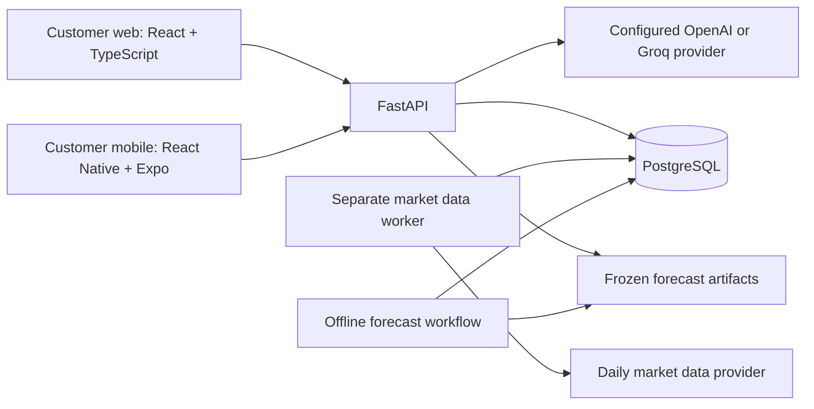

# Aura System Architecture

Aura is a portfolio risk education platform. The customer web and mobile
applications share a FastAPI backend and PostgreSQL database. This document
describes the implementation on `main`, reviewed on 2026-10-14; deployment
configuration and model artifacts must still be verified in each environment.

## Quick Navigation

- [System Overview](#system-overview)
- [Backend Responsibilities](#backend-responsibilities)
- [Portfolio Baselines and Valuation](#portfolio-baselines-and-valuation)
- [Analytics and Saved Snapshots](#analytics-and-saved-snapshots)
- [Forecasting](#forecasting)
- [Market Data Worker](#market-data-worker)
- [Authentication and Sessions](#authentication-and-sessions)
- [Persistence and Transactions](#persistence-and-transactions)
- [Customer Clients](#customer-clients)
- [Runtime Configuration](#runtime-configuration)
- [Repository Map](#repository-map)
- [Current Boundaries](#current-boundaries)
- [Related Documentation](#related-documentation)

## System Overview



Both clients call authenticated HTTP endpoints. They do not access PostgreSQL,
market data providers, or LLM credentials directly. The backend owns portfolio
valuation, historical analytics, simulations, currency conversion, forecast
inference, and account authorization.

The worker updates shared daily observations independently of customer requests.
Offline forecasting scripts produce versioned artifacts; normal API requests
load those artifacts without training models.

## Backend Responsibilities

The backend lives in `backend/app/`. Responsibilities follow the existing
route, service, calculation, and persistence boundaries.

| Module | Responsibility |
| --- | --- |
| `api/` | HTTP routes, request dependencies, authentication, ownership checks, and response handling |
| `schemas/` | Pydantic request and response contracts, including versioned snapshots |
| `services/` | Portfolio baseline resolution, workflow orchestration, snapshot mapping, forecasts, sessions, watchlists, and notifications |
| `analytics/` | Deterministic historical return, risk, contribution, and diversification calculations |
| `scenarios/` | Historical what-if and allocation scenario calculations |
| `forecasting/` | Feature and target construction, evaluation, artifact validation, and inference |
| `agents/` | LLM provider adapters, grounded tools, prompts, and guardrails |
| `data_pipeline/` | Market observation fetching, cleaning, validation, and persistence preparation |
| `scheduler/` | Worker scheduling, coordination, retries, and health bookkeeping |
| `database/` | SQLAlchemy models, connections, and repositories |
| `core/` | Configuration, security, supported instruments, and logging |
| `utils/` | Shared implementation helpers |

Routes call services; repositories handle database access under caller-owned
transactions. Calculation modules do not fetch provider data or save records.
Money and quantity boundaries use `Decimal`; numerical analytics use the
validated arrays and data frames appropriate to their calculations.

The public API covers accounts, portfolios and holdings, reports, simulations,
asset and portfolio outlooks, watchlists, notifications, AI explanations, and
market data status. Endpoint details belong in the
[public API contract](../api_contracts/public_api.md).

The AI service resolves an owned portfolio or saved report/simulation context
before calling the configured provider. Backend calculations and snapshots
supply the numerical facts. LLM responses explain those facts and remain subject
to educational guardrails.

## Portfolio Baselines and Valuation

### Persisted holding modes

| Mode | Saved facts | Analytics baseline |
| --- | --- | --- |
| `CURRENT` | Symbol, positive share quantity, ordered position, and optional purchase provenance | Current share quantities and derived current market allocations |
| `PLANNED` | Symbol, positive proposed amount, ordered position, and one plan currency (`USD` or `THB`) | Proposed amounts normalized into target allocations |
| `LEGACY` | Symbol, saved weight, and ordered position | Saved allocations for compatibility |

The modes are mutually exclusive. Current holdings do not persist derived
weights, prices, market values, or FX rates. Optional invested amount, investment
currency, and purchase date are supplied together or omitted together. Planned
holdings do not persist real share quantities or purchase provenance.

Legacy portfolios remain readable for existing data. They are not a separate
customer creation option. Replacing their holdings through the current-holdings
workflow can convert them to `CURRENT`.

### Shared baseline resolution

`PortfolioBaselineResolutionService` in
`services/portfolio_baseline_resolver.py` resolves the saved mode into canonical
allocations and any valuation or planned-allocation context. Report, simulation,
and forecast services use this boundary rather than deriving their own baseline.

For current holdings:

```text
holding_value_usd = share_quantity * latest_valid_usd_price
portfolio_value_usd = sum(holding_value_usd)
current_allocation = holding_value_usd / portfolio_value_usd
```

Valuation reads persisted daily observations. Supported asset prices and optional
USD/THB observations must satisfy the four-calendar-day freshness limit.
`THB=X` supplies THB per USD. A THB display converts USD amounts using that rate;
it does not change allocation or risk ratios.

Planned allocations come directly from proposed amounts in their shared plan
currency. Optional estimated-share previews use available prices and FX, but
remain best-effort previews. They are never saved as real holdings or used to
define the canonical planned baseline.

### Historical performance

Current-portfolio historical performance holds today's saved share quantities
fixed across the aligned historical price series:

```text
historical_portfolio_value[t] = sum(saved_shares[i] * historical_price[i, t])
historical_return[t] = historical_portfolio_value[t] / historical_portfolio_value[t-1] - 1
```

This does not reconstruct purchase transactions or cash flows. Purchase dates
remain provenance. Current allocations supply concentration, diversification,
and risk-contribution context.

Planned and legacy baselines use their resolved fixed allocations for historical
analytics. Their results describe allocation-based hypothetical performance.

## Analytics and Saved Snapshots

Historical analytics include cumulative and annualized returns, annualized
volatility, maximum drawdown, Sharpe ratio, correlations, concentration,
diversification, signed risk contributions, contributor rankings, and risk
classification. Maximum drawdown follows the negative-return convention.

Reports and simulations freeze their results in versioned JSONB payloads.

| Version | Baseline and captured context |
| --- | --- |
| V1 | Legacy allocation results |
| V2 | Current-holding facts, valuation and price dates, derived allocations, monetary values, optional FX context, and calculated results |
| V3 | Planned currency and proposed amounts, ordered target allocations, calculated results, and hypothetical-context disclosures |

Report snapshots retain portfolio and per-asset analytics. Simulation snapshots
retain the scenario inputs, original and modified allocations where applicable,
comparison results, and their baseline context. Supported simulation workflows
are historical scenarios, allocation comparisons, and combined scenarios.

Opening saved history reads the original snapshot. It does not recalculate
analytics, revalue holdings, or fetch today's FX rate.

New V2/V3 simulation snapshots can also capture a `currency_display` payload
with complete USD and THB monetary views and the conversion context. Both clients
select the supplied view. Older snapshots without that payload retain their
original supported currency.

Currency conversion changes monetary presentation only. It does not change
returns, volatility, weights, risk scores, or scenario assumptions.

## Forecasting

### Offline workflow and runtime inference

The forecasting package supports dataset construction, features and horizon
targets, chronological training/evaluation splits, candidate selection,
calibration, final evaluation, training, and artifact validation. These are
explicit offline workflows under `backend/scripts/`.

Versioned artifacts live under the ignored `backend/artifacts/forecasting/`
directory. Runtime configuration selects the expected artifact version.
Artifacts must be provisioned separately from source code.

API inference reads persisted historical observations and validated frozen
artifacts. It does not fit models, fetch new provider data, or persist a forecast
result as a report or simulation.

### Horizons and outputs

The primary outlook uses a 30-calendar-day horizon. Separate experimental
7-, 14-, and 21-calendar-day workflows use their own targets and artifacts.
Weekly results are not scaled versions of the 30-day output.

Outputs distinguish expected return from non-annualized horizon volatility.
Available asset prediction ranges carry their configured coverage and model
warnings. Portfolio outlooks combine component forecasts with historical
correlation; they do not invent daily price paths or portfolio prediction ranges.

Weekly contracts explicitly report `experimental: true` and
`predictive_quality_approved: false`. These are educational estimates with
mixed model quality, not approved reliable predictions.

### Portfolio and currency context

Current portfolios use their derived current allocations and exact current USD
values. Planned portfolios use proposed allocations and amounts in their plan
currency. Legacy portfolios provide allocation-based outlooks without an
invented monetary baseline.

Where available, backend `currency_display` data supplies USD/THB amounts for
portfolio outlooks. Conversion does not forecast future FX movement; the outlook
discloses the unchanged-FX assumption. Standalone asset outlooks do not invent
personal holding amounts.

Missing or stale history and invalid or unavailable artifacts produce an
unavailable response rather than fabricated output. Supported instruments and
freshness checks are enforced by the backend.

## Market Data Worker

Daily data refresh runs in a separately supervised Python process:

```bash
python -m backend.scripts.run_market_data_scheduler
```

The default schedule is 02:00 UTC, configurable through backend settings.
Daily collection normally ends at yesterday's UTC date to avoid an unfinished
daily bar. The registry contains 17 customer assets plus the internal
`THB=X` FX instrument.

The pipeline fetches, cleans, validates, and upserts observations by
`(symbol, date)`. PostgreSQL advisory locks coordinate worker leadership and
updates. Heartbeats, startup and hourly catch-up checks, and bounded retries
support recovery. Failed symbol updates preserve previously stored observations.

Observation writes and final refresh status are committed together.
Attempt and heartbeat bookkeeping use their own short transactions.

The authenticated `/api/market-data/status` endpoint reads shared coverage,
freshness, and worker status. Refreshing a customer page does not trigger a
provider fetch.

The worker must use the same database as the API and a connection that supports
session advisory locks. Generated files in `data/raw/` and `data/processed/`
are not the runtime database authority. See the
[market data worker guide](../development/market-data-worker.md) for connection,
scheduling, recovery, and operator commands.

## Authentication and Sessions

Passwords are hashed with Argon2. The backend issues HS256 Bearer JWTs with a
default 30-minute access-token lifetime. Authenticated endpoints resolve the
token subject to an existing user and enforce resource ownership.

### Web refresh sessions

Web sign-in uses `/api/auth/web/login`, `/refresh`, and `/logout`.

1. Login creates a persisted session, returns a short-lived access JWT, and sets
   the opaque `aura_refresh` cookie.
2. The browser restores a session through the cookie on startup and refreshes
   after an access-token rejection, retrying the original request once.
3. Each successful refresh consumes the previous token and rotates the cookie.
4. Logout revokes the server session and clears the cookie. The UI waits for the
   server acknowledgement and displays failures.

The refresh policy is seven days without authenticated activity or successful
refresh, or 30 days since the original sign-in, whichever occurs first.
Activity advances the idle deadline; it never extends the fixed maximum lifetime.

Web JWTs include a session identifier. The authentication dependency checks
session validity and records activity in a short transaction before endpoint
work. Revoked, idle-expired, or maximum-expired sessions cannot continue using
their otherwise unexpired JWTs.

Refresh tokens are random opaque credentials. PostgreSQL stores only their hashes,
session association, and rotation timestamps. A recently consumed token receives
a retryable conflict during the five-second concurrency window, without new
credentials. Later replay revokes the session.

The cookie is HttpOnly and scoped to `/api/auth/web`. Secure and SameSite settings
are configurable; production requires Secure, and `SameSite=None` requires
Secure. Web session endpoints validate the configured browser Origin and
`X-Aura-Web-Session: 1` header. Credentialed CORS uses explicit allowed origins.

The web client stores only the access token in `sessionStorage`. Refresh tokens
are never exposed in JSON responses or JavaScript storage. Refresh calls use
single-flight coordination and browser Web Locks where available. Response
guards prevent delayed requests from restoring a signed-out or different account.
An optional logout session identifier protects against clearing a newer session
established by another tab.

### Mobile and account changes

Mobile currently uses `/api/auth/login` and stores its access token in Expo
SecureStore. Startup validates the restored identity through the API. Mobile
sign-out clears local authentication, and expired credentials require sign-in.
The web cookie refresh flow is not implemented for mobile.

Password changes revoke all web sessions. Account deletion removes the user and
owned records, making subsequent token authentication fail. Legacy/mobile access
tokens do not carry a persisted web-session identifier; password changes do not
provide immediate revocation of those existing tokens.

## Persistence and Transactions

PostgreSQL persists account-owned facts, shared market observations, and frozen
results. SQLAlchemy models are registered through
`backend/app/database/models/__init__.py`.

| Tables | Stored responsibility |
| --- | --- |
| `users` | Account profile and password hash |
| `portfolios`, `holdings` | Owned portfolio metadata and ordered holding facts |
| `market_data` | Shared daily asset and FX observations |
| `market_data_refresh_state` | Refresh attempts, status, and worker heartbeat |
| `analyses`, `simulations` | Owned versioned report and simulation snapshots |
| `watchlist_items` | Account watchlist membership |
| `notifications`, `notification_preferences` | In-app activity records and account notification settings |
| `web_sessions`, `web_refresh_tokens` | Session lifetime, revocation, and hashed refresh-token rotation |

Repositories and business services flush changes without committing
caller-owned transactions. Routes commit successful mutations. Saving a report
or simulation and its associated notification happens in the same transaction;
failure rolls back the workflow.

Authentication activity commits separately before potentially expensive
analytics or LLM work, avoiding a long-held session-row lock. The worker owns its
refresh transactions independently of API requests.

Owned data is scoped by the authenticated user. Account deletion cascades through
owned records, while shared market observations remain available to other users.
Device-local preferences and exported files are outside database deletion.

## Customer Clients

Both clients support real backend account, portfolio, report, simulation,
forecast, watchlist, notification, and AI workflows. Current and planned
holdings, legacy compatibility, and V1/V2/V3 saved results are integrated.

| Concern | Customer web | Customer mobile |
| --- | --- | --- |
| Runtime | React, TypeScript, and Vite | React Native, TypeScript, and Expo |
| Entry and providers | `src/main.tsx`, auth, privacy, and Learn progress providers | `src/app/AppProviders.tsx`, auth, preferences, privacy, portfolio/report/simulation data, and navigation providers |
| Navigation | Application hash routes and protected pages | React Navigation auth, tabs, and feature stacks |
| API access | `src/api/` and centralized API client | `src/api/` and centralized API client |
| Authentication | Web refresh sessions and access-token storage | Bearer access token in SecureStore |
| Presentation | Shared components, pages, hooks, types, and utilities | Shared components, screens, feature modules, theme, hooks, types, and utilities |

Clients render and format backend results, including supplied monetary currency
views. They do not duplicate portfolio risk formulas, financial FX conversions,
or forecast inference.

Account and selection guards prevent stale responses from displaying another
account or portfolio's data. Loading, empty, unavailable, and failure states
remain part of the feature UI.

Learn lessons and completion progress are local client features. Privacy value
masking and applicable display preferences are also local; masking does not
change backend authorization. Local reset does not delete server portfolios or
saved results.

Notifications are account-owned in-app records with read/clear actions and
links to saved results. Foreground polling updates client activity views.
Mock data supports development and tests, not authoritative customer results.

## Runtime Configuration

The web application can be hosted separately from the API. Its public
`VITE_API_BASE_URL` and the mobile `EXPO_PUBLIC_API_URL` select the backend
origin. Database credentials, JWT secrets, and LLM keys remain backend-only.

Cross-origin hosting requires an explicit allowed web origin and credentialed
requests for refresh cookies. SameSite must match whether the deployed web and
API are same-site or cross-site. HTTPS and browser cookie policy affect cookie
delivery; hostname configuration is part of deployment verification.

The API and worker require the migrated PostgreSQL schema. Alembic migrations
live in `backend/alembic/`. The API requires the selected forecast artifacts
for available outlooks, and an enabled LLM provider requires its server-side key.
Deploying the API does not automatically start the separate data worker.

Local database setup, environment variables, and server commands are documented
in the development guides below and the root README.

## Repository Map

```text
AURA/
  backend/
    app/                     Shared API, business workflows, calculations, and persistence
    alembic/                 Database migrations
    scripts/                 Worker, data operations, and offline forecasting commands
    tests/                   Backend unit and integration checks
    artifacts/forecasting/   Separately provisioned, ignored model artifacts
  web-prototype-react/
    src/                     Customer web application
    tests/                   Web behavior and contract checks
  mobile/
    src/                     Customer mobile application
    tests/                   Mobile behavior and contract checks
  data/                      Generated local data outputs
  docs/
    architecture/            System architecture
    api_contracts/           Public and feature contracts
    development/             Setup and operational workflows
  PROJECT_CONTEXT.md         Product context and project constraints
  CURRENT_STATUS.md          Implementation checkpoints
  README.md                  Product overview and local setup entry point
```

## Current Boundaries

- Historical results describe the implemented holding or allocation baseline,
  not a reconstructed transaction ledger.
- Forecast outputs are educational estimates; weekly predictive quality is not
  approved.
- Planned-to-current atomic conversion is not implemented.
- Mobile refresh sessions, OAuth, MFA, and password-reset workflows are not
  implemented.
- Notifications are in-app; email delivery and push delivery are not implemented.
- Learn progress and local display preferences are not server-synchronized.

## Related Documentation

- [Product overview and setup](../../README.md)
- [Public API contract](../api_contracts/public_api.md)
- [Portfolio analysis contract](../api_contracts/portfolio_analysis.md)
- [Planned portfolio contract](../api_contracts/planned_portfolios.md)
- [Analytics response contract](../api_contracts/analytics_response.md)
- [Market data contract](../api_contracts/market_data.md)
- [Local environment setup](../development/local-environment-setup.md)
- [Running local servers](../development/running-local-servers.md)
- [Test database setup](../development/test-database-setup.md)
- [Market data worker operations](../development/market-data-worker.md)
- [Multi-horizon forecasting workflow](../development/multi-horizon-forecasting.md)
- [Forecasting selection provenance](../development/forecasting-selection-provenance.md)
